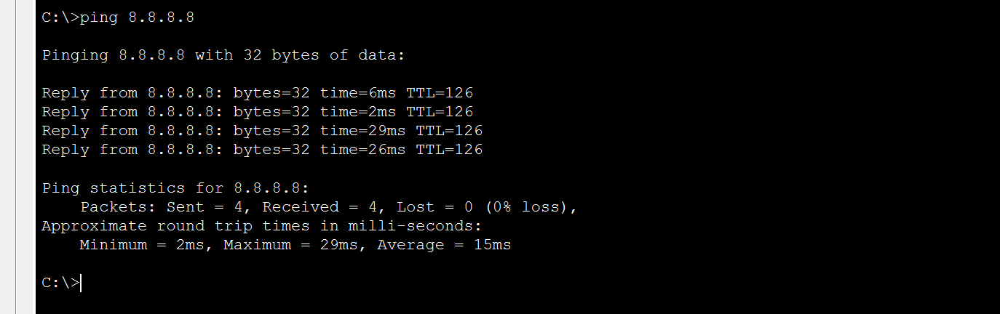
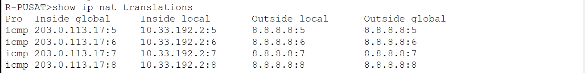

# UTS: Subnetting VLSM dan CIDR

Soal: rancang pengalamatan IP jaringan Smart City Surabaya dengan VLSM dan CIDR (7 router, 14 LAN, link L1–L6). Blok kelompok 4: `10.32.0.0/13`. Lembar soal ada di [`problems/`](problems/).

## Dokumen

| File                                       | Isi                                                                                                                    |
| ------------------------------------------ | ---------------------------------------------------------------------------------------------------------------------- |
| [`kebutuhan.md`](kebutuhan.md)             | Blok alamat, tabel kebutuhan tiap subnet (host, blok, prefix, mask)                                                    |
| [`topologi.md`](topologi.md)               | Skema topologi, link antar-router, LAN per router                                                                      |
| [`subnetting-vlsm.md`](subnetting-vlsm.md) | Alokasi VLSM dalam `10.32.0.0/16` (pemakaian 94,23%)                                                                   |
| [`subnetting-cidr.md`](subnetting-cidr.md) | Agregat per router, pohon penggabungan, alokasi CIDR dalam `10.32.0.0/15` (pemakaian 47,11%), perbandingan dengan VLSM |

## File Packet Tracer

| File                               | Skema |
| ---------------------------------- | ----- |
| [`ets-vlsm.pkt`](ets-vlsm.pkt)     | VLSM  |
| [`ets-cidr.pkt`](ets-cidr_fix.pkt) | CIDR  |

Keduanya memakai topologi yang sama: 7 router 2911 (link serial `HWIC-2T` antar-router), 14 switch 2960, dan satu PC atau server perwakilan tiap LAN.

Isi konfigurasi:

- IP interface router, `clock rate` sisi DCE, dan hostname.
- Static route dasar (default route ke atas, rute ke bawah di R-PUSAT dan R-UTARA).
- IP statis host `.2` (di LAN `10.32.240.128/25` pada VLSM host `.130`), gateway = host pertama.
- Ping lintas wilayah sudah diuji.

Nama perangkat di file ini masih format UTS (`SW-Pegawai`, `PC-Pegawai`). Format huruf besar dipakai di folder [`project/`](../project/).

---

# Laporan Subnetting Jaringan Smart City Surabaya (No. 2)

---

### File Tabel VLSM & CIDR

| File                                    | Keterangan                               |
| :-------------------------------------- | :--------------------------------------- |
| [VLSM & CIDR](TABEL_VLSM_DAN_CIDR.xlsx) | Tabel Alokasi VLSM, CIDR, dan Revisi UTS |

---

## 1. Tabel Alokasi VLSM (Murni Terbesar ke Terkecil)

- **IP Induk Base:** `10.32.0.0/16`
- **Metode:** Pengurutan alokasi subnet dari ukuran blok terbesar ke terkecil secara linier tanpa celah.

| No  | Subnet / LAN               | Ukuran Blok | Prefix | Network ID    | Subnet Mask     | Rentang Host Valid            | Broadcast     | Gateway (IP Router) |
| :-: | :------------------------- | :---------: | :----: | :------------ | :-------------- | :---------------------------- | :------------ | :-----------------: |
|  1  | WiFi Publik Utara          |   16.384    |  /18   | 10.32.0.0     | 255.255.192.0   | 10.32.0.2 – 10.32.63.254      | 10.32.63.255  |      10.32.0.1      |
|  2  | WiFi Publik Selatan        |    8.192    |  /19   | 10.32.64.0    | 255.255.224.0   | 10.32.64.2 – 10.32.95.254     | 10.32.95.255  |     10.32.64.1      |
|  3  | CCTV Kota                  |    8.192    |  /19   | 10.32.96.0    | 255.255.224.0   | 10.32.96.2 – 10.32.127.254    | 10.32.127.255 |     10.32.96.1      |
|  4  | WiFi Publik Timur          |    8.192    |  /19   | 10.32.128.0   | 255.255.224.0   | 10.32.128.2 – 10.32.159.254   | 10.32.159.255 |     10.32.128.1     |
|  5  | Sensor & SCADA Pelabuhan   |    8.192    |  /19   | 10.32.160.0   | 255.255.224.0   | 10.32.160.2 – 10.32.191.254   | 10.32.191.255 |     10.32.160.1     |
|  6  | WiFi Publik Barat          |    8.192    |  /19   | 10.32.192.0   | 255.255.224.0   | 10.32.192.2 – 10.32.223.254   | 10.32.223.255 |     10.32.192.1     |
|  7  | Pegawai Balai Kota         |    2.048    |  /21   | 10.32.224.0   | 255.255.248.0   | 10.32.224.2 – 10.32.231.254   | 10.32.231.255 |     10.32.224.1     |
|  8  | Sensor Banjir Timur        |    1.024    |  /22   | 10.32.232.0   | 255.255.252.0   | 10.32.232.2 – 10.32.235.254   | 10.32.235.255 |     10.32.232.1     |
|  9  | Sensor Lalu Lintas Utara   |     512     |  /23   | 10.32.236.0   | 255.255.254.0   | 10.32.236.2 – 10.32.237.254   | 10.32.237.255 |     10.32.236.1     |
| 10  | Puskesmas & Sekolah Barat  |     256     |  /24   | 10.32.238.0   | 255.255.255.0   | 10.32.238.2 – 10.32.238.254   | 10.32.238.255 |     10.32.238.1     |
| 11  | Server & Storage DC        |     256     |  /24   | 10.32.239.0   | 255.255.255.0   | 10.32.239.2 – 10.32.239.254   | 10.32.239.255 |     10.32.239.1     |
| 12  | Kantor Pelabuhan           |     128     |  /25   | 10.32.240.0   | 255.255.255.128 | 10.32.240.2 – 10.32.240.126   | 10.32.240.127 |     10.32.240.1     |
| 13  | PJU Pintar Selatan         |     128     |  /25   | 10.32.240.128 | 255.255.255.128 | 10.32.240.130 – 10.32.240.254 | 10.32.240.255 |    10.32.240.129    |
| 14  | Server Balai Kota          |     32      |  /27   | 10.32.241.0   | 255.255.255.224 | 10.32.241.2 – 10.32.241.30    | 10.32.241.31  |     10.32.241.1     |
| 15  | L1 (R-PUSAT – R-DC)        |      4      |  /30   | 10.32.241.32  | 255.255.255.252 | 10.32.241.33 – 10.32.241.34   | 10.32.241.35  |          -          |
| 16  | L2 (R-PUSAT – R-UTARA)     |      4      |  /30   | 10.32.241.36  | 255.255.255.252 | 10.32.241.37 – 10.32.241.38   | 10.32.241.39  |          -          |
| 17  | L3 (R-PUSAT – R-SELATAN)   |      4      |  /30   | 10.32.241.40  | 255.255.255.252 | 10.32.241.41 – 10.32.241.42   | 10.32.241.43  |          -          |
| 18  | L4 (R-PUSAT – R-TIMUR)     |      4      |  /30   | 10.32.241.44  | 255.255.255.252 | 10.32.241.45 – 10.32.241.46   | 10.32.241.47  |          -          |
| 19  | L5 (R-PUSAT – R-BARAT)     |      4      |  /30   | 10.32.241.48  | 255.255.255.252 | 10.32.241.49 – 10.32.241.50   | 10.32.241.51  |          -          |
| 20  | L6 (R-UTARA – R-PELABUHAN) |      4      |  /30   | 10.32.241.52  | 255.255.255.252 | 10.32.241.53 – 10.32.241.54   | 10.32.241.55  |          -          |

### Ringkasan Alokasi Alamat IP (VLSM)

- **Total alamat terpakai:** `61.752`
- **Blok induk:** `10.32.0.0/16`
- **Pemakaian:** **`94,23%`**

---

## 2. Skema Penggabungan CIDR (Supernetting & Alokasi Per Router)

### A. Agregat per Router (Supernetting)

| No  | Router      | Blok Induk  | Prefix Agregat | Rentang IP Teralokasi       |
| :-: | :---------- | :---------- | :------------: | :-------------------------- |
|  1  | R-UTARA     | 10.32.0.0   |      /17       | 10.32.0.0 – 10.32.127.255   |
|  2  | R-DC        | 10.32.128.0 |      /18       | 10.32.128.0 – 10.32.191.255 |
|  3  | R-PELABUHAN | 10.32.192.0 |      /18       | 10.32.192.0 – 10.32.255.255 |
|  4  | R-SELATAN   | 10.33.0.0   |      /18       | 10.33.0.0 – 10.33.63.255    |
|  5  | R-TIMUR     | 10.33.64.0  |      /18       | 10.33.64.0 – 10.33.127.255  |
|  6  | R-BARAT     | 10.33.128.0 |      /18       | 10.33.128.0 – 10.33.191.255 |
|  7  | R-PUSAT     | 10.33.192.0 |      /20       | 10.33.192.0 – 10.33.207.255 |

### B. Tabel Alokasi LAN & Link CIDR

| Router                | Subnet / LAN                | Prefix | Network ID   | Rentang Host Valid          | Broadcast     | Gateway / Keterangan |
| :-------------------- | :-------------------------- | :----: | :----------- | :-------------------------- | :------------ | :------------------- |
| R-UTARA               | WiFi Publik Utara           |  /18   | 10.32.0.0    | 10.32.0.1 – 10.32.63.254    | 10.32.63.255  | 10.32.0.1            |
| R-UTARA               | Sensor Lalu Lintas Utara    |  /23   | 10.32.64.0   | 10.32.64.1 – 10.32.65.254   | 10.32.65.255  | 10.32.64.1           |
| R-DC                  | CCTV Kota                   |  /19   | 10.32.128.0  | 10.32.128.1 – 10.32.159.254 | 10.32.159.255 | 10.32.128.1          |
| R-DC                  | Server dan Storage DC       |  /24   | 10.32.160.0  | 10.32.160.1 – 10.32.160.254 | 10.32.160.255 | 10.32.160.1          |
| R-PELABUHAN           | Sensor dan SCADA Pelabuhan  |  /19   | 10.32.192.0  | 10.32.192.1 – 10.32.223.254 | 10.32.223.255 | 10.32.192.1          |
| R-PELABUHAN           | Kantor Pelabuhan            |  /25   | 10.32.224.0  | 10.32.224.1 – 10.32.224.126 | 10.32.224.127 | 10.32.224.1          |
| R-SELATAN             | WiFi Publik Selatan         |  /19   | 10.33.0.0    | 10.33.0.1 – 10.33.31.254    | 10.33.31.255  | 10.33.0.1            |
| R-SELATAN             | PJU Pintar Selatan          |  /25   | 10.33.32.0   | 10.33.32.1 – 10.33.32.126   | 10.33.32.127  | 10.33.32.1           |
| R-TIMUR               | WiFi Publik Timur           |  /19   | 10.33.64.0   | 10.33.64.1 – 10.33.95.254   | 10.33.95.255  | 10.33.64.1           |
| R-TIMUR               | Sensor Banjir Timur         |  /22   | 10.33.96.0   | 10.33.96.1 – 10.33.99.254   | 10.33.99.255  | 10.33.96.1           |
| R-BARAT               | WiFi Publik Barat           |  /19   | 10.33.128.0  | 10.33.128.1 – 10.33.159.254 | 10.33.159.255 | 10.33.128.1          |
| R-BARAT               | Puskesmas dan Sekolah Barat |  /24   | 10.33.160.0  | 10.33.160.1 – 10.33.160.254 | 10.33.160.255 | 10.33.160.1          |
| R-PUSAT               | Pegawai Balai Kota          |  /21   | 10.33.192.0  | 10.33.192.1 – 10.33.199.254 | 10.33.199.255 | 10.33.192.1          |
| R-PUSAT               | Server Balai Kota           |  /27   | 10.33.200.0  | 10.33.200.1 – 10.33.200.30  | 10.33.200.31  | 10.33.200.1          |
| R-PUSAT / R-DC        | L1 R-PUSAT – R-DC           |  /30   | 10.33.200.32 | 10.33.200.33 – 10.33.200.34 | 10.33.200.35  | -                    |
| R-PUSAT / R-UTARA     | L2 R-PUSAT – R-UTARA        |  /30   | 10.33.200.36 | 10.33.200.37 – 10.33.200.38 | 10.33.200.39  | -                    |
| R-PUSAT / R-SELATAN   | L3 R-PUSAT – R-SELATAN      |  /30   | 10.33.200.40 | 10.33.200.41 – 10.33.200.42 | 10.33.200.43  | -                    |
| R-PUSAT / R-TIMUR     | L4 R-PUSAT – R-TIMUR        |  /30   | 10.33.200.44 | 10.33.200.45 – 10.33.200.46 | 10.33.200.47  | -                    |
| R-PUSAT / R-BARAT     | L5 R-PUSAT – R-BARAT        |  /30   | 10.33.200.48 | 10.33.200.49 – 10.33.200.50 | 10.33.200.51  | -                    |
| R-UTARA / R-PELABUHAN | L6 R-UTARA – R-PELABUHAN    |  /30   | 10.32.66.0   | 10.32.66.1 – 10.32.66.2     | 10.32.66.3    | -                    |
| R-PUSAT / R-ISP       | Link R-PUSAT ke R-ISP       |  /30   | 203.0.113.16 | 203.0.113.17 – 203.0.113.18 | 203.0.113.19  | 203.0.113.18 (R-ISP) |
| R-PUSAT / R-PELABUHAN | Tunnel GRE                  |  /30   | 192.168.4.0  | 192.168.4.1 – 192.168.4.2   | 192.168.4.3   | Tunnel Interface     |
| R-ISP                 | Server Internet             |  /24   | 8.8.8.0      | 8.8.8.1 – 8.8.8.254         | 8.8.8.255     | 8.8.8.1 (R-ISP)      |

### Ringkasan Alokasi Alamat IP (CIDR)

- **Total alamat terpakai:** `61.752`
- **Blok induk:** `10.32.0.0/15`
- **Pemakaian:** **`47,11%`**

---

## 3. Catatan Perbaikan & Revisi Hasil UTS

Pencatatan resmi perbaikan kesalahan perhitungan dari lembar kerja UTS untuk memastikan efisiensi dan konsistensi laporan:

| No  | Subnet / Komponen         | Jawaban di UTS (Sebelum Revisi)                                | Perbaikan (Hasil Benar)                                                                           | Alasan Kesalahan / Analisis Koreksi                                                                                                                                                                             |
| :-: | :------------------------ | :------------------------------------------------------------- | :------------------------------------------------------------------------------------------------ | :-------------------------------------------------------------------------------------------------------------------------------------------------------------------------------------------------------------- |
|  1  | **R-DC**                  | Offset: `28675`<br>Network: `10.32.128.0`                      | Offset: `28672`<br>Network: `10.32.112.0`                                                         | Salah dalam melakukan akumulasi penjumlahan offset dari subnet sebelumnya ($24576 + 4096 = 28672$) serta salah konversi ke oktet ke-3 ($28672 / 256 = 112$).                                                    |
|  2  | **R-Pelabuhan**           | Offset: `30720`<br>Network: `10.32.136.0`                      | Offset: `30720`<br>Network: `10.32.120.0`                                                         | Offset dasar sudah benar ($28672 + 2048 = 30720$), namun terjadi kesalahan pembagian oktet ke-3 ($30720 / 256 = 120$, bukan 136).                                                                               |
|  3  | **R-Barat**               | Offset: `31744`<br>Network: `10.32.140.0`                      | Offset: `31744`<br>Network: `10.32.124.0`                                                         | Terjadi kesalahan perambatan (_propagation error_) konversi IP dari kesalahan pembagian oktet ke-3 pada baris sebelumnya ($31744 / 256 = 124$).                                                                 |
|  4  | **R-Pusat**               | Offset: `32256`<br>Network: `10.32.142.0`                      | Offset: `32256`<br>Network: `10.32.126.0`                                                         | Terjadi kesalahan perambatan konversi IP dari kesalahan pembagian oktet ke-3 ($32256 / 256 = 126$).                                                                                                             |
|  5  | **L1 – L6 (Link Router)** | Offset: `32515` dst.<br>Network: `10.32.193.0 – 10.32.199.25`  | Offset: `32512` dst.<br>Network: `10.32.127.0 – 10.32.127.52`                                     | Typo penulisan offset akumulasi ($32256 + 256 = 32512$) dan kesalahan perambatan oktet ke-3 ($32512 / 256 = 127$).                                                                                              |
|  6  | **Seluruh Subnet LAN**    | Range Host mencantumkan `.2` sebagai IP awal di beberapa baris | Range Host diseragamkan mencantumkan `.1` sampai `.254` (Host Valid), dengan `.1` sebagai Gateway | Pada UTS, Gateway diambil pada IP pertama (`.1`), sehingga IP host valid diawali dari IP kedua (`.2`). Format penulisan disempurnakan agar mencakup seluruh Usable Host Range dan kolom Gateway dipisah khusus. |

---

## Konfigurasi NAT Overload (PAT) dan Skema Routing Topologi Jaringan (Soal 5)

---

### **1. Tujuan Praktikum**

- Mengonfigurasi Network Address Translation (NAT) Overload / Port Address Translation (PAT) pada Router Pusat (`R-PUSAT`).
- Menerapkan akses kontrol (_access-list_) untuk mengizinkan seluruh subnet jaringan internal (`10.0.0.0/8`) mengakses jaringan luar/internet.
- Mengonfigurasi Router ISP (`R-ISP`) dan Server Internet (`8.8.8.8`) untuk memvalidasi keberhasilan translasi IP privat menjadi IP publik.
- Membuktikan keberhasilan koneksi end-to-end melalui pengujian `ping` dan pemantauan tabel translasi NAT.

---

### **2. Topologi dan Alamat IP**

- **IP Publik R-PUSAT ke R-ISP (`Serial0/2/1`):** `203.0.113.17 /30`
- **IP Publik R-ISP ke R-PUSAT (`Serial0/3/0`):** `203.0.113.18 /30`
- **IP Server Internet (`8.8.8.8`):** `8.8.8.1 /24` (Gateway pada `R-ISP` interface `GigabitEthernet0/0`)
- **Jaringan Internal:** Seluruh perangkat client internal menggunakan segmen IP privat `10.0.0.0/8`.

---

### **3. Langkah-Langkah Konfigurasi**

#### **A. Konfigurasi pada R-PUSAT (NAT Gateway)**

Akses CLI `R-PUSAT`, lalu jalankan perintah berikut untuk mendefinisikan _access-list_, menandai interface _inside_ dan _outside_, serta mengaktifkan NAT Overload dan _default route_:

```text
enable
configure terminal

! 1. Buat Access List untuk mencakup seluruh jaringan internal 10.0.0.0/8
access-list 1 permit 10.0.0.0 0.255.255.255

! 2. Tandai interface internal (LAN dan link serial cabang) sebagai "ip nat inside"
interface GigabitEthernet0/0
 ip nat inside
exit

interface GigabitEthernet0/1
 ip nat inside
exit

interface Serial0/0/0
 ip nat inside
exit

interface Serial0/0/1
 ip nat inside
exit

interface Serial0/1/0
 ip nat inside
exit

interface Serial0/1/1
 ip nat inside
exit

interface Serial0/2/0
 ip nat inside
exit

! 3. Tandai interface yang mengarah ke R-ISP sebagai "ip nat outside"
interface Serial0/2/1
 ip address 203.0.113.17 255.255.255.252
 ip nat outside
 no shutdown
exit

! 4. Terapkan NAT Overload (PAT) menggunakan interface publik
ip nat inside source list 1 interface Serial0/2/1 overload

! 5. Konfigurasi Default Route mengarah ke R-ISP
ip route 0.0.0.0 0.0.0.0 203.0.113.18

end
write
```

#### **B. Konfigurasi pada R-ISP**

Akses CLI R-ISP, lalu pasang modul serial (misalnya HWIC-2T) dan jalankan konfigurasi interface berikut:

```text
enable
configure terminal

hostname R-ISP

! Interface Serial yang terhubung ke R-PUSAT
interface Serial0/3/0
 ip address 203.0.113.18 255.255.255.252
 clock rate 64000
 no shutdown
exit

! Interface yang mengarah ke Server Internet (8.8.8.8)
interface GigabitEthernet0/0
 ip address 8.8.8.1 255.255.255.0
 no shutdown
exit

end
write
```

#### **C. Konfigurasi pada Server Internet (Server0 / Server-Internet)**

1. Buka tab Desktop
2. Masukkan parameter berikut:

- IPv4 Address: 8.8.8.8
- Subnet Mask: 255.255.255.0
- Default Gateway: 8.8.8.1

### **4. Hasil Pengujian dan Verifikasi**

#### **A. Pengujian Konektivitas (Ping Test)**

Dilakukan pengujian dari PC internal (contoh: PC-Pegawai dengan IP 10.33.192.2) menuju Server Internet (8.8.8.8):

```bash
C:\>ping 8.8.8.8

Pinging 8.8.8.8 with 32 bytes of data:

Reply from 8.8.8.8: bytes=32 time=6ms TTL=126
Reply from 8.8.8.8: bytes=32 time=2ms TTL=126
Reply from 8.8.8.8: bytes=32 time=29ms TTL=126
Reply from 8.8.8.8: bytes=32 time=26ms TTL=126

Ping statistics for 8.8.8.8:
    Packets: Sent = 4, Received = 4, Lost = 0 (0% loss),
```



#### **B. Verifikasi Tabel Translasi NAT**

Dilakukan pengecekan pada CLI R-PUSAT menggunakan perintah:

```bash
R-PUSAT#show ip nat translations
Contoh Output Tabel Translasi:

Plaintext
Pro Inside global      Inside local       Outside local      Outside global
icmp 203.0.113.17:5    10.33.192.2:5      8.8.8.8:5          8.8.8.8:5
icmp 203.0.113.17:6    10.33.192.2:6      8.8.8.8:6          8.8.8.8:6
icmp 203.0.113.17:7    10.33.192.2:7      8.8.8.8:7          8.8.8.8:7
icmp 203.0.113.17:8    10.33.192.2:8      8.8.8.8:8          8.8.8.8:8
```



- Analisis: IP privat internal 10.33.192.2 terbukti berhasil ditranslasikan secara dinamis menggunakan port berbeda ke satu alamat IP publik 203.0.113.17 milik R-PUSAT.
